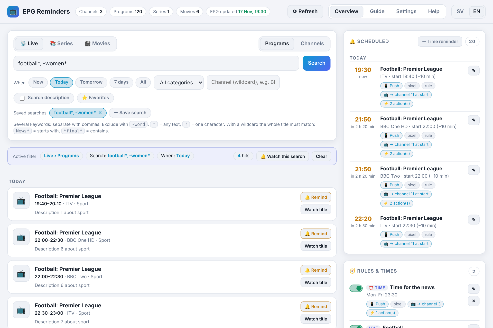
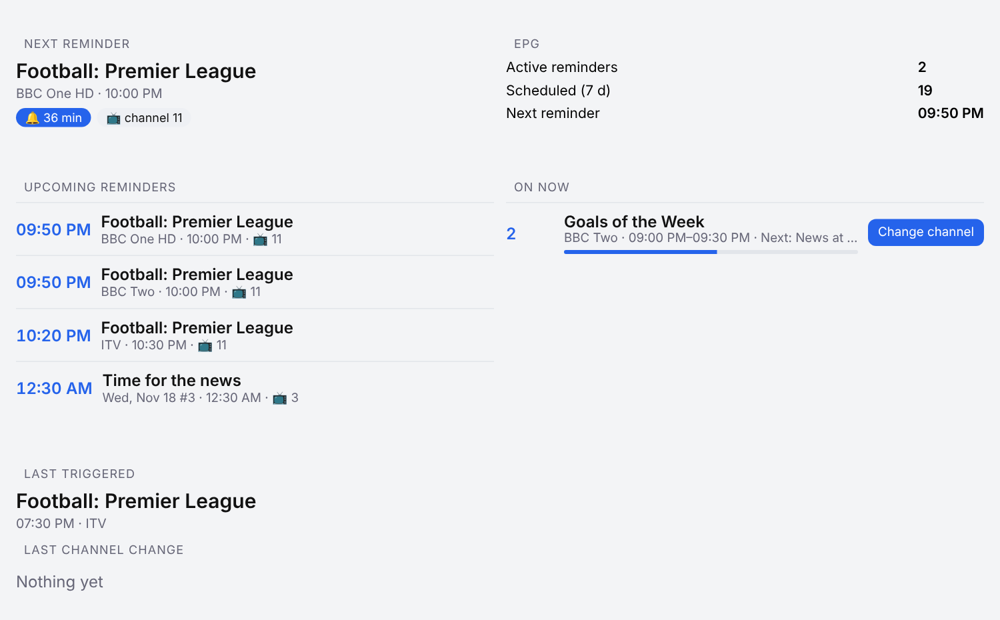

# mickego Home Assistant Add-ons

🇬🇧 English · 🇸🇪 [Svenska längre ned](#svenska)

## Add-ons

### 📺 IPTV EPG Reminders (`iptv_epg_reminder`)
Search live programs, series and movies from your IPTV/EPG provider (wildcards, exclusions, saved searches), browse a TV guide grid and get reminders through Home Assistant: push, voice (TTS), sound, any service, entity changes and automatic channel change on your TV box. Interface in Swedish, English, German, French, Norwegian and Finnish.

## Install

1. Click the button above, **or** go to **Settings → Add-ons → Add-on store → ⋮ → Repositories** and add `https://github.com/mickego/ha-addons`.
2. Reload the page, find **IPTV EPG Påminnelser** in the store and press **Install**.
3. Open **Configuration**, enter your `epg_url` (XMLTV/Xtream), **Start** and enable **Show in sidebar**.
4. Update later via **⋮ → Check for updates**.

Enable *Advanced mode* in your user profile if you can't see the Repositories entry.

## Dashboard cards
Five Lovelace cards (next reminder, upcoming list, on now with channel-change button, last activity, status) for any dashboard – they read the add-on's sensors, so they work through Nabu Casa too.
Copy [`dashboard-cards/epg-cards.js`](dashboard-cards/epg-cards.js) to `/config/www/`, add `/local/epg-cards.js` as a *JavaScript module* under Settings → Dashboards → ⋮ → Resources, then add a card and search for **EPG**.

## Documentation
- [Full guide (EN, PDF)](docs/IPTV-EPG-Reminders-Guide-EN.pdf)
- [Full guide (SV, PDF)](docs/IPTV-EPG-Paminnelser-Guide-SV.pdf)
- [Quick guide (SV + EN, PDF)](docs/Quick-Guide-SV-EN.pdf)
- [Add-on docs](iptv_epg_reminder/DOCS.md) · [Changelog](iptv_epg_reminder/CHANGELOG.md)

Your EPG address and login are only stored in the add-on configuration on your Home Assistant. Nothing is sent to third parties.

## Svenska

### 📺 IPTV EPG Påminnelser
Sök live-program, serier och filmer från din IPTV/EPG-leverantör (jokertecken, uteslutning, sparade sökningar), bläddra i en tablå och få påminnelser via Home Assistant: push, uppläsning (TTS), ljud, valfri tjänst, entitetsändring och automatiskt kanalbyte på TV-boxen.

### Dashboardkort
Fem Lovelace-kort (nästa påminnelse, kommande, just nu med kanalbyte, senaste aktivitet, status) för valfri dashboard. Kopiera [`dashboard-cards/epg-cards.js`](dashboard-cards/epg-cards.js) till `/config/www/`, lägg till `/local/epg-cards.js` som *JavaScript-modul* under Inställningar → Dashboards → ⋮ → Resurser och sök efter **EPG** i kortväljaren. Gränssnittet finns på svenska, engelska, tyska, franska, norska och finska.

### Installera
1. Tryck på knappen ovan, **eller** gå till **Inställningar → Tillägg → Tilläggsbutik → ⋮ → Förråd** och lägg till `https://github.com/mickego/ha-addons`.
2. Ladda om sidan, hitta **IPTV EPG Påminnelser** i butiken och tryck **Installera**.
3. Fyll i `epg_url` under **Konfiguration**, **Starta** och slå på **Visa i sidofältet**.
4. Uppdatera via **⋮ → Sök efter uppdateringar**.

Dokumentation: se PDF-guiderna ovan (svensk guide och snabbguide).

## License
MIT
